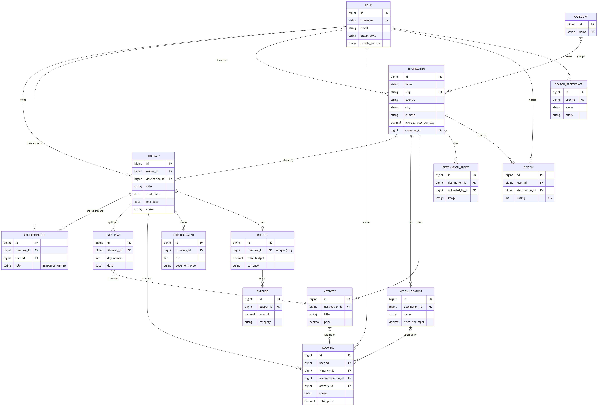
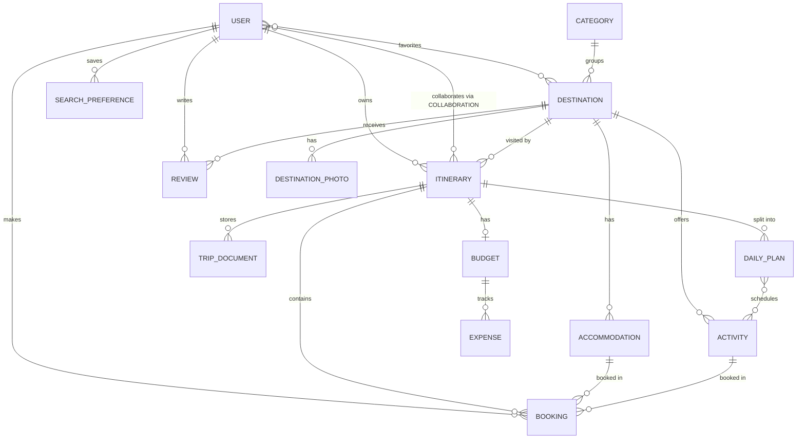

# Travel Itinerary Planning & Booking API

A REST API for planning trips with friends: build day-by-day itineraries, book accommodation and activities, track budgets and expenses, attach travel documents, and review destinations. Trips are shared with collaborators who are either **editors** or **viewers**.

## Technologies

Python 3.10 · Django 5.0 · Django REST Framework · Simple JWT · django-filter · drf-spectacular (OpenAPI) · ReportLab (PDF export) · Pillow · python-decouple · SQLite or PostgreSQL · pytest, pytest-django, pytest-cov

## Installation

```bash
python -m venv venv
venv\Scripts\activate            # macOS/Linux: source venv/bin/activate
pip install -r requirements.txt
cp .env.example .env             # then edit values
```

## Environment variables

All settings are read from `.env` (see `.env.example`):

| Variable | Purpose |
|---|---|
| `DJANGO_ENV` | `development` (default), `production` or `test` |
| `SECRET_KEY` | Required in production |
| `DEBUG`, `ALLOWED_HOSTS` | Standard Django settings |
| `DB_ENGINE` | `sqlite` (default) or `postgresql` |
| `DB_NAME`, `DB_USER`, `DB_PASSWORD`, `DB_HOST`, `DB_PORT` | PostgreSQL connection |
| `JWT_ACCESS_MINUTES`, `JWT_REFRESH_DAYS` | Token lifetimes |
| `EMAIL_BACKEND`, `DEFAULT_FROM_EMAIL`, `FRONTEND_URL` | Notifications and password-reset links |
| `MAX_UPLOAD_SIZE_MB`, `LOG_LEVEL` | Upload limit, logging |

## Database setup

SQLite works out of the box. For PostgreSQL, create a database and set `DB_ENGINE=postgresql` plus the `DB_*` variables.

```bash
python manage.py migrate            # run migrations
python manage.py createsuperuser    # admin at /admin/
python manage.py runserver          # http://127.0.0.1:8000/
```

## Running tests

```bash
pytest                 # run the suite (in-memory test database)
pytest --cov           # with coverage report; fails below 75%
```

## Authentication flow

1. `POST /api/v1/accounts/register/` creates an account.
2. `POST /api/v1/accounts/login/` returns `access` and `refresh` JWTs.
3. Send `Authorization: Bearer <access>` with every request.
4. When the access token expires, `POST /api/v1/accounts/token/refresh/`.
5. `POST /api/v1/accounts/logout/` blacklists the refresh token.

Password change and reset: `/accounts/password/change/`, `/accounts/password/reset/`, `/accounts/password/reset/confirm/`.

## API endpoints

All under `/api/v1/`. Interactive docs: **`/api/docs/`** (Swagger) and **`/api/redoc/`**.

| Resource | Endpoints |
|---|---|
| Accounts | `accounts/register/`, `login/`, `token/refresh/`, `token/verify/`, `logout/`, `me/`, `users/<username>/` |
| Destinations | `destinations/` (CRUD), `search/`, `slug/<slug>/`, `favorites/`, `<id>/favorite/`, `<id>/weather_info/`, `<id>/popular_activities/`, `<id>/reviews/`, `<id>/photos/`, `<id>/accommodations/`, `<id>/activities/` |
| Catalogue | `categories/`, `accommodations/`, `activities/` (read-only) |
| Itineraries | `itineraries/` (CRUD), `upcoming/`, `budget-status/`, `<id>/duplicate/`, `<id>/export_pdf/`, `<id>/share/` |
| Trips | `trips/search/`, `trips/mine/`, `trips/<id>/report/`, `<id>/collaborators/`, `<id>/daily-plans/`, `<id>/documents/`, `<id>/bookings/` |
| Bookings | `bookings/` (CRUD), `<id>/confirm/`, `<id>/cancel/`, `bulk-update/`, `mine/<id>/` |
| Budgets | `budgets/` (CRUD), `<id>/expenses/`, `<id>/expenses/<pk>/` |
| Reviews | `reviews/` (CRUD), `mine/`, `by-user/<username>/` |
| Analytics | `analytics/`, `budget_summary/`, `destination_preferences/` |

## Example requests

```bash
# Log in
curl -X POST http://127.0.0.1:8000/api/v1/accounts/login/ \
  -d "username=alice&password=Sup3rSecret!"

# Create a trip with a plan for each day
curl -X POST http://127.0.0.1:8000/api/v1/itineraries/ -H "Authorization: Bearer $TOKEN" \
  -H "Content-Type: application/json" \
  -d '{"title":"Paris in spring","destination":1,"start_date":"2026-04-01","end_date":"2026-04-05","generate_daily_plans":true}'

# Book a hotel (price calculated from nights x rooms)
curl -X POST http://127.0.0.1:8000/api/v1/bookings/ -H "Authorization: Bearer $TOKEN" \
  -d "itinerary=1&booking_type=ACCOMMODATION&accommodation=2&check_in=2026-04-01&check_out=2026-04-04"

# Upload a ticket
curl -X POST http://127.0.0.1:8000/api/v1/trips/1/documents/ -H "Authorization: Bearer $TOKEN" \
  -F title="Flight" -F document_type=TICKET -F file=@ticket.pdf
```

Errors always use one shape: `{"error": {"status_code": 400, "message": "...", "details": {...}}}`.

## Project structure

```
travel_api/     settings (base/development/production/test), URLs, shared validators,
                pagination, permissions, exception handler
accounts/       custom User, registration, JWT login, profile, passwords
destinations/   destinations, categories, photos, saved searches
itineraries/    trips, daily plans, collaborators, documents, reports
bookings/       accommodations, activities, bookings
budgets/        budgets, expenses, analytics
reviews/        destination reviews
```

Each app has `models`, `serializers`, `views`, `urls`, `permissions`/`filters` and a `tests/` package.

## ERD



Source: [`docs/erd.mmd`](docs/erd.mmd). Relationships at a glance:


